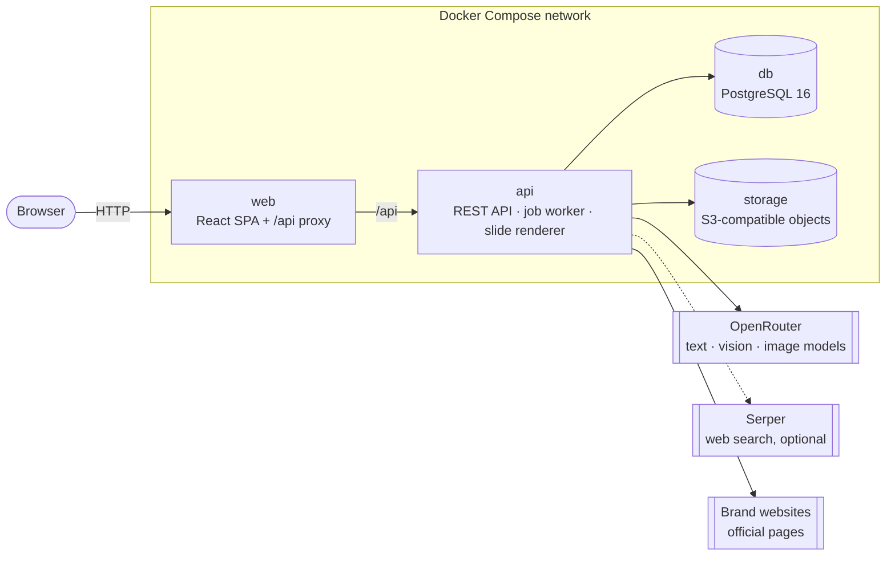

# 02 · System architecture

Four containers run on one Docker Compose network: `web`, `api`, `db` and `storage`. The browser only reaches `web`. API keys exist only inside `api` and never reach the frontend.

## Containers

| Container | Responsibility                                                                                                                                                      | Dev port                 |
| --------- | ------------------------------------------------------------------------------------------------------------------------------------------------------------------- | ------------------------ |
| `web`     | Serves the React SPA and proxies `/api` to the API. In development this is the Vite dev server, in the image it is nginx.                                           | 5173 (dev), 8080 (image) |
| `api`     | REST API, the pg-boss worker in the same process, and the Playwright slide renderer                                                                                 | 3000                     |
| `db`      | PostgreSQL 16: runs, phases, jobs and asset metadata                                                                                                                | 5432                     |
| `storage` | SeaweedFS S3 gateway locally ([ADR 0008](adr/0008-seaweedfs-locally-r2-in-production.md)): uploaded references, generated backgrounds, rendered slides, export ZIPs | 8333                     |

## External services

| Service        | Used for                                                                          | Required                                                   |
| -------------- | --------------------------------------------------------------------------------- | ---------------------------------------------------------- |
| OpenRouter     | Every LLM, vision and image-generation call                                       | Yes                                                        |
| Serper         | Discovering official pages and product pages                                      | No. Without a key the run uses only the links in the brief |
| Brand websites | Downloaded and converted to text in the research phase; `robots.txt` is respected | Yes, at least the links in the brief                       |

## Trust boundaries

- The browser never sees an API key. All calls to external services go through `api`.
- The frontend never reads the bucket directly. The API streams every file ([Storage and rendering](09-storage-and-rendering.md)).
- Downloaded web pages and LLM outputs are untrusted data. They are validated against Zod schemas before use.

## Worker placement

The worker starts inside the `api` process to keep startup simple. If it needs to scale separately later, the same code can run as its own service from a second entry point, with no code change in the phases.
