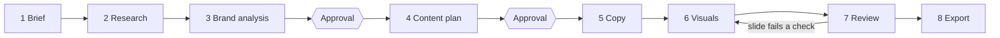
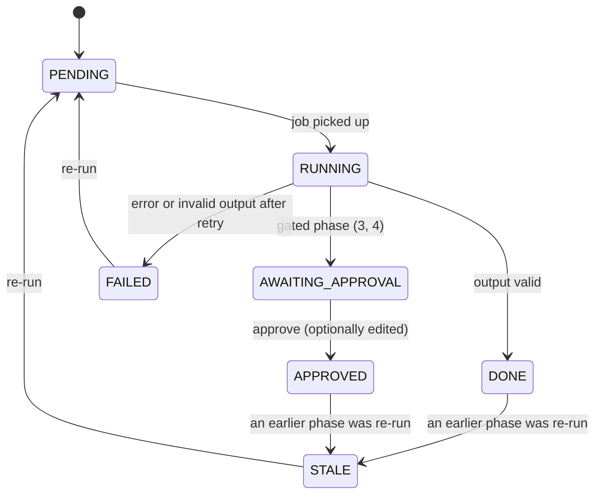

# 03 · Generation pipeline

A run moves through eight phases. Each phase is a separate pg-boss job, and its output is saved as JSON in `PhaseRun.output`. After phase 3 (analysis) and phase 4 (plan) the run waits for a person to approve or edit the result. Only then does the next phase start.

## Phases

| #   | Phase          | Input                                     | What it does                                                                                                                                                           | Output                                                  |
| --- | -------------- | ----------------------------------------- | ---------------------------------------------------------------------------------------------------------------------------------------------------------------------- | ------------------------------------------------------- |
| 1   | Brief          | Form                                      | Brand name, Instagram profile, website and shop links, products, audience, goals, inspiration; uploaded screenshots, product photos and logo                           | `brief.json`, assets in storage                         |
| 2   | Research       | Brief                                     | Finds official pages and product pages with Serper (if a key is set). The backend downloads them and converts them to clean text                                       | `sources[]`: URL, title, excerpt, fetch time, reachable |
| 3   | Brand analysis | Brief, sources, screenshots               | A vision model describes tone of voice, audience, themes, colours and how products and people are shown. Each claim is `verified` (with a source link) or `assumption` | `brandAnalysis.json`, then **approval**                 |
| 4   | Content plan   | Approved analysis                         | Three posts, each with goal, format (image, carousel, story), concept, rationale and the product it features                                                           | `contentPlan.json`, then **approval**                   |
| 5   | Copy           | Approved plan, sources                    | Instagram caption, hashtags and slide text in Croatian or English. Only facts, prices and product features from sources may be used                                    | `copy.json` per post and slide                          |
| 6   | Visuals        | Copy, brand colours, product photos, logo | An image model generates a background or scene. The slide is a React template rendered to PNG by Playwright, with the real product photo, logo and text                | PNGs in storage, `Asset` rows                           |
| 7   | Review         | Rendered slides, copy, sources            | A vision model plus rules: logo and product visible, text readable, no unsourced claims, correct size (1080×1350, 1080×1920). A failing slide goes back to phase 6     | `review.json` (score, issues)                           |
| 8   | Export         | Everything above                          | ZIP with a folder per post (images, `caption.txt`, `meta.json` with format, goal and rationale), plus `sources.md` and every intermediate JSON                         | Downloadable ZIP                                        |

## Phase state machine

The run itself has a coarser status (`DRAFT`, `RUNNING`, `AWAITING_APPROVAL`, `COMPLETED`, `FAILED`) derived from its phases.

## Approval gates

- The approver can accept the AI proposal as it is or edit it first.
- The original stays in `output`, the edited version goes to `editedOutput`. Later phases read `editedOutput` when it exists.
- The difference between the two is the "own correction" example required for the PDF, read straight from the database.

## Run status

The run status is derived from the latest attempt of each phase: `RUNNING` while any phase is queued or running, `AWAITING_APPROVAL` at a gate, `FAILED` when a phase failed, `COMPLETED` when all eight are done or approved, otherwise `DRAFT` (not started, or paused with stale phases). **Start** (shown as **Continue** after the first run) queues the first phase that is missing, failed or stale.

## Retries

A failed attempt goes back to the queue and is retried twice with exponential backoff. After the last retry the phase is `FAILED` with its error message, and **Continue** starts it again as a new attempt.

## Resumability and traceability

- A run can restart from any finished phase: `POST /api/runs/:id/phases/:phase/rerun`. All later phases become `STALE`.
- Each re-run creates a new `PhaseRun` row with a higher `attempt`, so earlier attempts are kept.
- Every `PhaseRun` stores the prompt id (for example `analysis@v3`), the model, token counts and cost. Any result can be traced back to what produced it.
- A cost cap per run (`MAX_COST_USD_PER_RUN`) stops the run before it exceeds the budget.

## Grounding rules

1. Only downloaded official pages count as sources. A search snippet is never a fact.
2. Every claim in the analysis is labelled `verified` (with a source URL) or `assumption`.
3. The copy phase may only use facts, prices and product features that appear in a source.
4. No statement or quote is attributed to a real person (founder, athlete, customer, influencer) unless it is quoted word for word from a source, with its link.
5. The review phase flags any claim without a source and any attributed statement that is not in a source.
