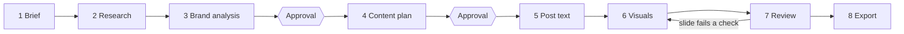
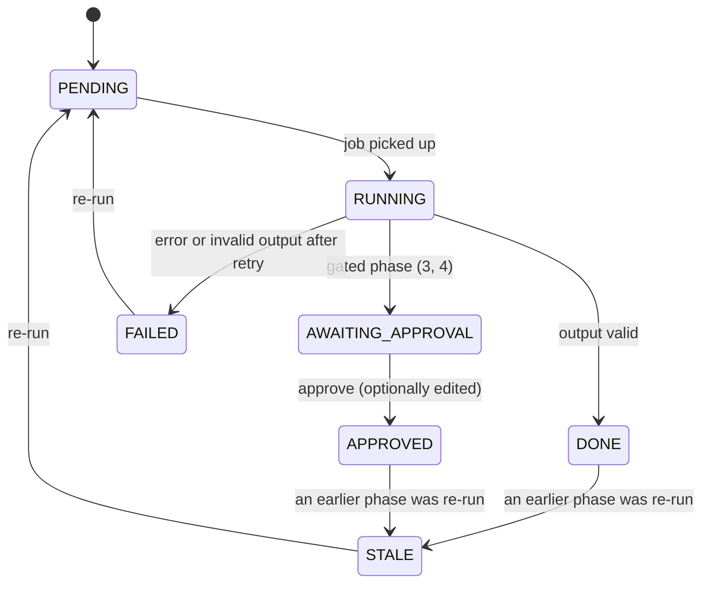

# 03 · Generation pipeline

A run moves through eight phases. Each phase is a separate pg-boss job, and its output is saved as JSON in `PhaseRun.output`. After phase 3 (analysis) and phase 4 (plan) the run waits for a person to approve or edit the result. Only then does the next phase start.

## Phases

| #   | Phase              | Input                                     | What it does                                                                                                                                                                                                                     | Output                                                                       |
| --- | ------------------ | ----------------------------------------- | -------------------------------------------------------------------------------------------------------------------------------------------------------------------------------------------------------------------------------- | ---------------------------------------------------------------------------- |
| 1   | Brief              | Form                                      | Brand name, Instagram profile, website and shop links, products, audience, goals, inspiration; uploaded screenshots, product photos and logo                                                                                     | `brief.json`, assets in storage                                              |
| 2   | Research           | Brief                                     | Reads the brief's links and product pages, plus Serper results for the brand and its first two products (if a key is set). The backend downloads them and converts them to clean text; unreadable pages are kept with the reason | `sources[]`: URL, title, excerpt, text, origin, fetch time, reachable, error |
| 3   | Brand analysis     | Brief, sources, screenshots               | A vision model describes tone of voice, audience, themes, colours and how products and people are shown. Each claim is `verified` (with a source link) or `assumption`                                                           | `brandAnalysis.json`, then **approval**                                      |
| 4   | Content plan       | Approved analysis                         | Three posts, each with goal, format (image, carousel, story), concept, rationale and the product it features                                                                                                                     | `contentPlan.json`, then **approval**                                        |
| 5   | Post text (`COPY`) | Approved plan, sources                    | Instagram caption, hashtags and slide text in Croatian or English. Only facts, prices and product features from sources may be used                                                                                              | `copy.json` per post and slide                                               |
| 6   | Visuals            | Copy, brand colours, product photos, logo | An image model generates a background or scene. The slide is a React template rendered to PNG by Playwright, with the real product photo, logo and text                                                                          | PNGs in storage, `Asset` rows                                                |
| 7   | Review             | Rendered slides, copy, sources            | A vision model plus rules: logo and product visible, text readable, no unsourced claims, correct size (1080×1350, 1080×1920). A failing slide goes back to phase 6                                                               | `review.json` (score, issues)                                                |
| 8   | Export             | Everything above                          | ZIP with a folder per post (images, `caption.txt`, `meta.json` with format, goal and rationale), plus `sources.md` and every intermediate JSON                                                                                   | Downloadable ZIP                                                             |

## Research and analysis in detail

**Research** collects at most 12 pages: first the brief's links and product pages, then search results (brand name, and brand name with each of the first two products; Croatian results for a Croatian brief). Search results on the brand's own domains (those of the brief's links) come before third-party pages; tracking parameters (`utm_*`, `srsltid`, `gclid`, …) are removed, a result on another site is kept only if its title, snippet or address names the brand (short brand names also find unrelated companies), and duplicates (the same page apart from its query, `#…`, a trailing slash or host case) and social networks are dropped; a social link in the brief is listed as unreachable, because the uploaded screenshots stand in for it ([ADR 0006](adr/0006-screenshots-instead-of-instagram-scraping.md)). Each page is downloaded by the fetcher: only public http(s) addresses, `robots.txt` respected, redirects followed and checked, 10 s timeout, 2 MB limit, then reduced to its title, meta description and main text (navigation, header, footer, scripts removed). A page that cannot be read stays in the list with the reason (`HTTP 404`, `Blocked by robots.txt`, `Timed out`, …), so the analysis and the hand-in can name unavailable sources. The sources are also saved as `Source` rows; re-running research replaces them.

**Style source.** The brief chooses where the analysis reads the brand's look from, one or the other: the **uploaded images** (screenshots of the Instagram feed, as before) or **the website**. In website mode the research phase also opens up to three of the brand's own readable pages from the brief in headless Chromium (desktop size, a cookie banner closed if found), takes up to three screenshots per page from top to bottom (five in all, `CAPTURED_SCREENSHOT`) and reads the colours the page's own styles use most (the `theme-color` tag, then backgrounds, text, buttons and gradient stops; any CSS colour format; greys and browser-default link colours left out). The analysis then gets these screenshots and colours instead of the uploaded screenshots; the logo and product photos are used in both modes, because they go on the slides. Without an uploaded product photo, the cover of each post shows one of the website screenshots (a different one per post) in a browser frame, so software and service brands show their real product instead of an invented screen. Instagram is never downloaded ([ADR 0006](adr/0006-screenshots-instead-of-instagram-scraping.md)), and the profile URL is optional.

**Analysis** sends the brief, the text of every readable source (and the reason for every unreadable one) and the uploaded images to a vision model with the `analysis` prompt. Images are scaled to at most 1280 px; SVG logos become PNG. The answer must match `AnalysisOutput`: summary, tone, audience, themes, visual style, colours (hex, name, usage), how products and people are shown, claims and gaps. A claim the model marks `verified` must cite a page that was actually read; otherwise the phase turns it into an `assumption`.

**Plan and post text.** The plan prompt returns exactly three posts (index, format, goal, concept, rationale, product). Approving the plan, with the person's edits, creates the three `Post` rows. The copy prompt writes caption, hashtags and slide texts in the language of the run, using only verified facts and no words of real people; its answer is then checked by fixed rules: every number and quote that appears in neither the brief, a source page nor an analysis evidence quote is listed as "check before publishing". The copy is written onto the `Post` rows.

**Visuals.** One AI background per post (no text, products, people or interfaces on screens in it), then every slide is rendered from the React template with the uploaded logo and product photo and the post text, and saved as a PNG; see [09 · Storage and rendering](09-storage-and-rendering.md). The operator can regenerate a single slide with an instruction and edit the caption afterwards.

**Review and export.** The review renders nothing new unless needed: fixed rules check that every slide has a PNG of the exact size, and a vision model (`review` prompt) looks at small copies of all slides for unreadable text, stray text or faces in the background, a missing logo or product, and a poor brand fit. A failing slide is made again once with its issues as the instruction and checked again; the score is the share of slides that pass. Numbers or quotes the copy check could not find in a source are listed as run-wide issues. The export builds the hand-over ZIP (a folder per post with the slides, `caption.txt` and `meta.json`, plus `sources.md`, the brief and every phase output); downloading it later always rebuilds it with the latest edits.

**Language.** The brief's language (Croatian or English) is the language of the whole run: the analysis, the plan and the posts are written in it. It is chosen in the brief and cannot change once the run has started, so a run's results are in one language. JSON keys and fixed values (`IMAGE`, `verified`) stay in English, and `evidence` quotes stay word for word in the language of their source. The interface language (EN/HR switch) does not change it.

## Phase state machine

The run itself has a coarser status (`DRAFT`, `RUNNING`, `AWAITING_APPROVAL`, `COMPLETED`, `FAILED`) derived from its phases.

## Approval gates

- The approver can accept the AI proposal as it is or edit it first.
- The original stays in `output`, the edited version goes to `editedOutput`. Later phases read `editedOutput` when it exists.
- The difference between the two is the "own correction" example required for the PDF, read straight from the database.

## Run status

The run status is derived from the latest attempt of each phase: `RUNNING` while any phase is queued or running, `AWAITING_APPROVAL` at a gate, `FAILED` when a phase failed, `COMPLETED` when all eight are done or approved, otherwise `DRAFT` (not started, or paused with stale phases). A new run is a `DRAFT` and does not start by itself: the operator can still edit the brief and add or remove references, and the edit is refused once any phase has run. **Start** (shown as **Continue** after the first run) queues the first phase that is missing, failed or stale.

## Retries

A failed attempt goes back to the queue and is retried twice with exponential backoff. After the last retry the phase is `FAILED` with its error message, and **Continue** starts it again as a new attempt. Errors that another attempt cannot fix fail the phase at once: OpenRouter refusing the request (bad key, no credit, 400) and the cost cap. Tokens and cost are saved for every attempt, failed ones included.

## Resumability and traceability

- A run can restart from any finished phase: `POST /api/runs/:id/phases/:phase/rerun`. All later phases become `STALE`.
- Each re-run creates a new `PhaseRun` row with a higher `attempt`, so earlier attempts are kept.
- Every `PhaseRun` stores the prompt id (for example `analysis@v3`), the model, token counts and cost. Any result can be traced back to what produced it.
- A cost cap per run (`MAX_COST_USD_PER_RUN`, default $2) is checked before every LLM call against everything the run has spent so far (all attempts). Once it is reached, the phase fails with a clear message instead of calling the model.

## Grounding rules

1. Only downloaded official pages count as sources. A search snippet is never a fact.
2. Every claim in the analysis is labelled `verified` (with a source URL) or `assumption`.
3. The copy phase may only use facts, prices and product features that appear in a source.
4. No statement or quote is attributed to a real person (founder, athlete, customer, influencer) unless it is quoted word for word from a source, with its link.
5. The review phase flags any claim without a source and any attributed statement that is not in a source.
