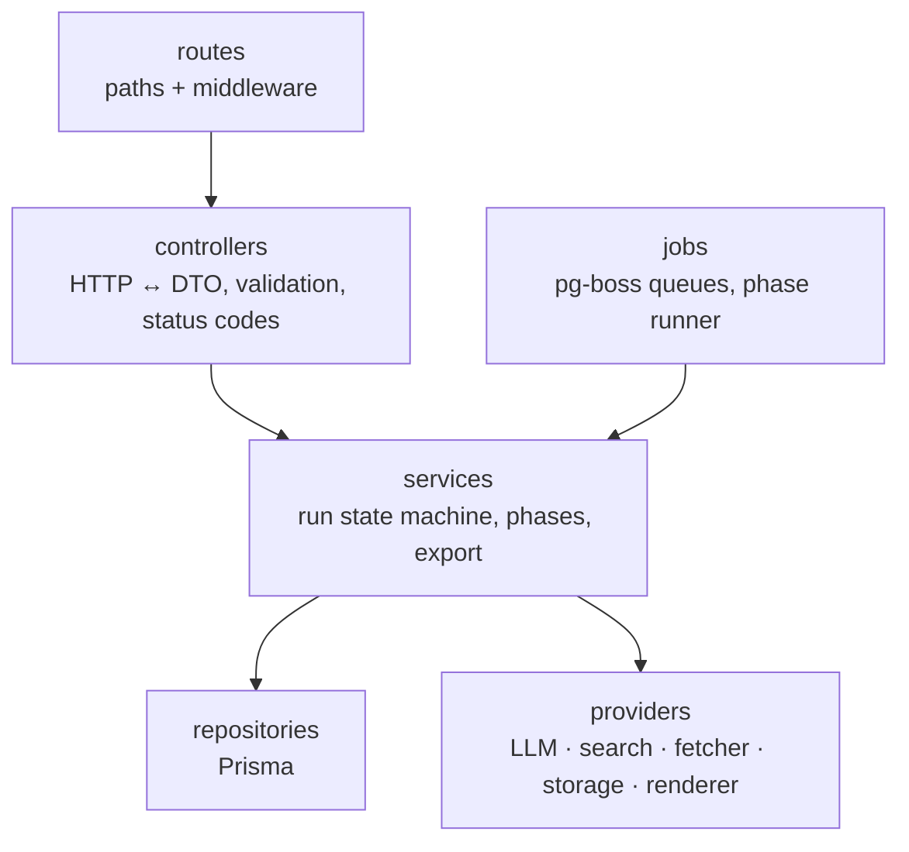

# 05 · Backend (`apps/api`)

The API uses strict layers that only call downwards: route → controller → service → repository or provider. Services know nothing about Express, repositories know nothing about business rules, and every external system sits behind an interface so tests can replace it.



## Folder layout

Each layer folder is split into one subfolder per domain (`asset`, `run`, `phase-run`, `source`, `health`, …), so it is clear which file belongs to what. Tests sit next to the file they test.

```
apps/api/src/
├─ app.ts                   # builds the Express app from its dependencies (tests inject fakes)
├─ server.ts                # starts the HTTP server and the worker
├─ config/env.ts            # environment variables validated with Zod
├─ db/prisma.ts             # Prisma client with the pg driver adapter
├─ controllers/             # HTTP ↔ DTO, Zod validation, status codes
│  ├─ asset/                # asset.controller.ts (+ .test.ts)
│  ├─ health/               # health.controller.ts
│  └─ run/                  # run.controller.ts
├─ services/
│  ├─ asset/                # asset.service.ts: upload, open
│  ├─ run/                  # run.service.ts: creating, listing and reading runs
│  ├─ pipeline/             # pipeline.service.ts: state machine (start, approve, re-run); run-status.ts
│  ├─ phases/               # one file per phase: brief, research, analysis, plan, copy, visuals, review, export
│  └─ export/               # export.service.ts: builds the ZIP
├─ repositories/            # Prisma access, one folder per table
│  ├─ run/                  # run.repo.ts (+ .test.ts)
│  ├─ phase-run/            # phase-run.repo.ts
│  ├─ asset/                # asset.repo.ts
│  └─ source/               # source.repo.ts
├─ providers/               # interface + implementation for each external system
│  ├─ llm/                  # LlmProvider: OpenRouterProvider, FakeLlmProvider (no key, tests)
│  ├─ search/               # SearchProvider: SerperProvider, NoopSearchProvider (no key)
│  ├─ fetcher/              # downloads a page, HTML → clean text, respects robots.txt
│  ├─ storage/              # StorageProvider: S3Storage, MemoryStorage (tests)
│  ├─ queue/                # JobQueue: PgBossQueue (+ an in-memory queue for tests)
│  └─ renderer/             # SlideRenderer: Playwright, slide templates → PNG
├─ jobs/                    # phase-runner.ts (claim, execute, validate, retry), metered-llm.ts (usage, cost cap), queue names
├─ middleware/              # error handler, upload (multer)
├─ lib/                     # logger (pino), errors (AppError hierarchy), validate
└─ test/                    # shared test helpers: test context, fixtures
```

Routes are registered in `app.ts` while there are few of them; they move to `routes/` when it grows.

## Phase contract

Every phase implements the same interface:

```ts
interface Phase<K extends PhaseKey> {
  key: K
  outputSchema: ZodType<PhaseOutputs[K]>
  execute(ctx: PhaseContext): Promise<PhaseResult<PhaseOutputs[K]>>
}
// PhaseResult = { output, promptId?, model?, usage? }
```

The output schemas live in `packages/shared` (`PHASE_OUTPUT_SCHEMAS`), so the approval panel validates edits with the same schema as the API. `PhaseContext` carries the brief, the finished outputs of earlier phases (`editedOutput` when a person approved one, otherwise `output`) and the LLM provider. A phase never writes to the database.

The **phase runner** (`jobs/phase-runner.ts`) handles one job: it claims the phase run (`PENDING` → `RUNNING`, skipped if another delivery already took it), calls `execute`, validates the output and hands it to `PipelineService.complete`. A failed attempt goes back to `PENDING` and the queue retries it with backoff (2 retries); after the last one the phase is `FAILED` with the error. The **pipeline service** owns every status change; each change and the job it queues are one transaction.

## Job queue

Phases run as background jobs. The services and the phase runner depend on a small interface, not on pg-boss:

```ts
interface JobQueue {
  start(): Promise<void>
  stop(): Promise<void>
  send<T>(
    queue: string,
    data: T,
    options?: { tx?: TransactionClient },
  ): Promise<void>
  work<T>(
    queue: string,
    handler: (job: {
      data: T
      retryCount: number
      retryLimit: number
    }) => Promise<void>,
  ): Promise<void>
}
```

`PgBossQueue` (`providers/queue/`) implements it on the existing Postgres ([ADR 0002](adr/0002-postgres-job-queue-with-pg-boss.md)). `send` can join the caller's transaction, so a phase status change and its job are committed together. Tests use `MemoryQueue`, which runs jobs (and the jobs they send) when the test calls `drain()`.

> [!TIP]
> **Further scaling: BullMQ + Redis.** The queue can move to BullMQ on Redis by adding a `BullMqQueue` that implements `JobQueue`; nothing else changes. It needs a Redis service and an outbox table, because the database update and the Redis job are no longer one transaction. See the scaling path in ADR 0002.

## Rules

| Topic          | Rule                                                                                                                                                                         |
| -------------- | ---------------------------------------------------------------------------------------------------------------------------------------------------------------------------- |
| LLM output     | Always validated with a Zod schema (structured output or JSON mode). On invalid output the call is retried once with the validation error; after that the phase is `FAILED`. |
| External calls | OpenRouter calls have a timeout and exponential backoff. Token counts and cost of every call are saved on the `PhaseRun`.                                                    |
| Models         | No model names in code. The prompt file's front matter sets the model; `.env` can override it.                                                                               |
| Cost           | The phase runner checks `MAX_COST_USD_PER_RUN` before each call and fails the phase if the cap would be exceeded.                                                            |
| Errors         | One error shape for every response: `{ "error": { "code", "message", "details?" } }`. Domain errors extend `AppError` and map to status codes in one `errorHandler`.         |
| State changes  | Only `PipelineService` changes run and phase status. An illegal transition returns `409 Conflict`.                                                                           |
| Logging        | Structured JSON logs with pino, with a request id on every line. Prompts and API keys are never logged.                                                                      |

## LLM calls

Phases call the model through `runPrompt(ctx, promptId, schema, values, images?)`: the prompt comes from `packages/prompts` (Markdown with front matter: id, version, model, `maxTokens` (default 8000, which also bounds the cost of a call) and an optional `temperature`, sent only when set because many current models refuse it; `MODEL_<ID>` in the environment overrides the model) and its id with version (`analysis@v1`) is saved on the `PhaseRun`.

`OpenRouterProvider` sends the system and user text, the images as data URLs, and a JSON schema built from the Zod schema (`response_format: json_schema`, strict; keywords some providers reject, such as `minItems` or `pattern`, are dropped from the schema (never from field names) and checked by Zod afterwards). It only routes to providers that support structured output, asks for usage with cost, and has a timeout (`LLM_TIMEOUT_MS`, 120 s). Network errors, 429 and 5xx are retried three times with backoff; 400/401/402 fail at once. An answer that is not valid JSON or does not match the schema is sent back once with the validation errors.

The phase runner wraps the provider in `MeteredLlm` for each attempt: it adds up tokens and cost of every call (failed ones too) and refuses a call once the run has spent `MAX_COST_USD_PER_RUN`. Without `OPENROUTER_API_KEY` the API uses `FakeLlmProvider` with recorded answers, logs a warning, reports `llm: "fake"` in `/api/health`, and the web app shows a demo-mode banner.

> **Current state:** research and analysis are real (fetcher, Serper, OpenRouter vision); plan and copy have first prompts that M6 refines; visuals, review and export are placeholders until M7–M8.
