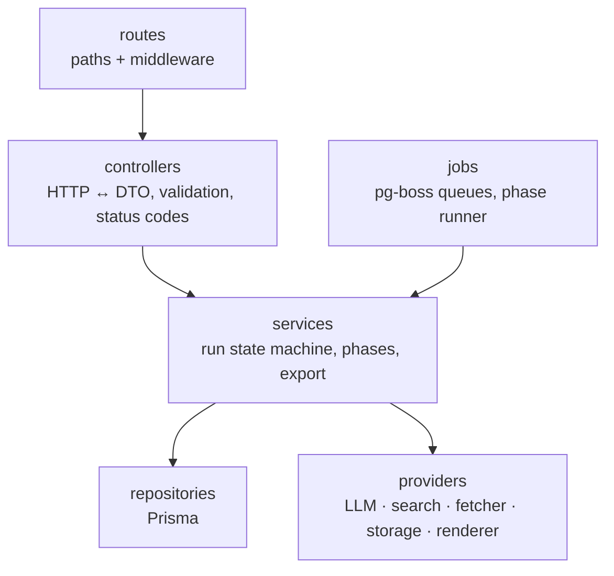

# 05 · Backend (`apps/api`)

The API uses strict layers that only call downwards: route → controller → service → repository or provider. Services know nothing about Express, repositories know nothing about business rules, and every external system sits behind an interface so tests can replace it.



## Folder layout

```
apps/api/src/
├─ app.ts                   # builds the Express app (usable from tests without a port)
├─ server.ts                # starts the HTTP server and the worker
├─ config/env.ts            # environment variables validated with Zod
├─ routes/                  # /runs, /assets, /health: paths and middleware only
├─ controllers/             # HTTP ↔ DTO, Zod validation, status codes
├─ services/
│  ├─ run.service.ts        # creating runs, state machine, approval, re-run
│  ├─ phases/               # one file per phase: brief, research, analysis, plan, copy, visuals, review, export
│  └─ export.service.ts     # builds the ZIP
├─ repositories/            # Prisma access: RunRepo, PhaseRunRepo, AssetRepo, SourceRepo
├─ providers/               # interface + implementation for each external system
│  ├─ llm/                  # LlmProvider: OpenRouterProvider (+ FakeLlmProvider for tests)
│  ├─ search/               # SearchProvider: SerperProvider, NoopSearchProvider (no key)
│  ├─ fetcher/              # downloads a page, HTML → clean text, respects robots.txt
│  ├─ storage/              # StorageProvider: S3Storage
│  └─ renderer/             # SlideRenderer: Playwright, slide templates → PNG
├─ jobs/                    # pg-boss: queue registration, phase runner, retries
├─ middleware/              # errorHandler, requestId, upload (multer), rateLimit
└─ lib/                     # logger (pino), errors (AppError hierarchy)
```

## Phase contract

Every phase implements the same interface:

```ts
interface Phase<TOutput> {
  key: PhaseKey
  outputSchema: ZodType<TOutput>
  execute(ctx: PhaseContext): Promise<TOutput>
}
```

`PhaseContext` carries the run, the approved outputs of earlier phases (`editedOutput` when it exists, otherwise `output`) and the providers. A phase never writes to the database. The **phase runner** in `jobs/` does that: it marks the phase `RUNNING`, calls `execute`, validates the output, saves it with token usage and cost, and moves the state machine on.

## Rules

| Topic          | Rule                                                                                                                                                                         |
| -------------- | ---------------------------------------------------------------------------------------------------------------------------------------------------------------------------- |
| LLM output     | Always validated with a Zod schema (structured output or JSON mode). On invalid output the call is retried once with the validation error; after that the phase is `FAILED`. |
| External calls | OpenRouter calls have a timeout and exponential backoff. Token counts and cost of every call are saved on the `PhaseRun`.                                                    |
| Models         | No model names in code. The prompt file's front matter sets the model; `.env` can override it.                                                                               |
| Cost           | The phase runner checks `MAX_COST_USD_PER_RUN` before each call and fails the phase if the cap would be exceeded.                                                            |
| Errors         | One error shape for every response: `{ "error": { "code", "message", "details?" } }`. Domain errors extend `AppError` and map to status codes in one `errorHandler`.         |
| State changes  | Only `run.service` changes run and phase status. An illegal transition returns `409 Conflict`.                                                                               |
| Logging        | Structured JSON logs with pino, with a request id on every line. Prompts and API keys are never logged.                                                                      |

> **Current state:** `app.ts`, `server.ts` and `config/env.ts` exist, with `GET /api/health`. The rest of the layout is filled in from M2 onwards.
