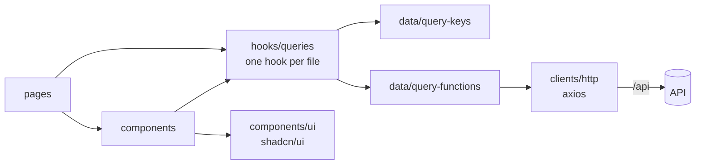

# 06 · Frontend (`apps/web`)

The frontend uses plain functions and hooks, no classes. Components never call the HTTP client directly: data flows page or component → query hook → query function → HTTP client. Forms use React Hook Form with the Zod schemas from `packages/shared`, the same ones the backend validates with.



## Folder layout

```
apps/web/src/
├─ main.tsx                 # providers + router
├─ router.tsx               # route table (React Router)
├─ clients/http.ts          # axios instance and httpClient { get, post, put, patch, delete }
├─ contexts/query-client.tsx# QueryClient: retry, cache time, error toasts for failed queries
├─ data/
│  ├─ query-keys/           # key factories per domain: all, lists(), details(), detail(id)
│  └─ query-functions/      # plain functions per domain that call httpClient
├─ hooks/
│  ├─ queries/<domain>/     # useGetRunsInfinite, useGetRunById, useCreateRun, useUploadAsset, …
│  └─ useTheme.ts           # other hooks
├─ i18n/                    # i18next setup, LanguageRoute (/:lang), locales/en.ts and locales/hr.ts
├─ layouts/                 # app-layout: header, language and theme toggles, toaster
├─ pages/                   # runs, add-run, edit-run, run-details
├─ components/              # brief-form, asset-uploader, run-status-badge, theme-toggle, …
│  └─ ui/                   # shadcn/ui components
├─ utils/                   # helpers (API error messages), upload rules
├─ lib/utils.ts             # shadcn class-name helper
└─ test/                    # MSW server, render helper, setup
```

## Query layer conventions

- **Query keys** live in `data/query-keys/<domain>.ts` as a factory, so invalidation can target all lists or one detail.
- **Query functions** live in `data/query-functions/<domain>.ts` and only call `httpClient`; types come from `packages/shared`.
- **Hooks** live in `hooks/queries/<domain>/`, one per file. Query hooks take optional `queryOptions`; mutation hooks invalidate the affected keys and show an error toast.
- **Lists are infinite queries**: `use<Name>Infinite({ params, queryOptions })` takes `{ page: 1, size: DEFAULT_PAGE_SIZE }` (20, from `packages/shared`), asks for the next page while `page < totalPages`, and returns the flattened items with `hasNextPage` and `fetchNextPage`. The page renders an `InfiniteScrollSpinner` after the last item; `react-infinite-scroll-hook` loads the next page when it scrolls into view.
- Failed queries show a toast from the shared `QueryCache` handler; form errors are shown next to their fields.

## Theme

Dark is the default (`class="dark"` on `<html>`). The header toggle switches to light and stores the choice in `localStorage`; a small inline script in `index.html` applies it before first paint.

## Languages

The interface is in English and Croatian (`react-i18next`). The language is the first segment of every URL (`/en/runs/…`, `/hr/runs/…`), so each language version has its own address that search engines can index and people can share. This is separate from the brief's output language, which sets the language of the generated posts.

- **Routing:** every page sits under `/:lang` (`LanguageRoute`). A path without a valid language (`/`, or an old link such as `/runs/1`) redirects to the same page in the preferred language: the last choice (kept in `localStorage`), else Croatian for a Croatian browser, else English. Links are built with `useLocalizedPath()`.
- **Switching:** the **EN | HR** buttons in the header open the same page under the other language's URL.
- **SEO tags:** each page renders `<link rel="canonical">`, `<link rel="alternate" hreflang="en|hr|x-default">` and a translated `<meta name="description">`; React places them in `<head>`. `<html lang>` follows the URL (set before first paint in `index.html`, then by i18next).
- **Texts** live in `i18n/locales/en.ts`; `hr.ts` has the type of the English file, so a missing or misspelled key fails the type check. `t()` keys are type-checked too.
- **Validation** uses the shared brief schema: `createBriefSchema(messages)` in `packages/shared` takes the messages, the API uses the English ones and the form passes translated ones, so the rules stay in one place. Shown errors are re-validated when the language changes.
- **API errors** are translated by their `code` (`apiErrors.*`); an unknown code falls back to the API's English message. Phase errors from the pipeline stay as the API wrote them.
- Dates are formatted in the interface language.

> [!NOTE]
> The pages are rendered in the browser. Google renders JavaScript, so the tags above are seen, but other crawlers may not run it. If public pages (e.g. a landing page) are added later, prerendering them per language would make them visible to every crawler. Run pages hold private work and should be `noindex` on a public domain.

## Layout and scrolling

The app fills the screen: the header stays put and `main` scrolls pages that are taller than the screen. List pages (runs) fill `main` and scroll only their list, with the `scrollbar-thin` utility from `index.css` (thin, theme-aware). The infinite scroll observes that list container (`rootRef`).

## Pages

Every path below sits under the language prefix (`/en`, `/hr`).

| Page                          | Purpose                                                                                                                                         |
| ----------------------------- | ----------------------------------------------------------------------------------------------------------------------------------------------- |
| Runs (`/`)                    | Lists earlier runs with their status; starts a new run                                                                                          |
| New run (`/runs/new`)         | Collects the brief in a multi-step wizard and uploads the reference files                                                                       |
| Edit brief (`/runs/:id/edit`) | The same wizard, filled with the saved brief, where uploads can be added or removed; only while the run has not started                         |
| Run details (`/runs/:id`)     | Shows the brief and uploads; later the phase timeline and each phase result; hosts the approval panel, the slide previews and the export button |

## Brief form fields

1. Brand name, Instagram profile URL and a short reason for choosing the brand.
2. Website, shop and catalogue links (several allowed).
3. Products to promote (name and product page URL).
4. Target audience, goals, role models and inspiration (text and links).
5. Uploads: Instagram screenshots, product photos, logo (PNG or SVG), other references.
6. Output language (Croatian or English) and preferred formats (optional preselection).

## Status updates

The `useGetRunById` hook will poll every 2 seconds while any phase is `RUNNING` and stops when none is. Polling is simpler than server-sent events and is enough for a single user.

## Approval panel

The approval panel turns the phase JSON into an editable form (for example, one card per post in the content plan). Saving sends the edited version with the approval, so the original AI proposal stays untouched in `output`.

> **Current state:** runs list, the brief wizard with uploads (also used to edit the brief until the run starts), and the run details page with the brief, references, the phase timeline (status, attempt, duration, cost, model, prompt, output) and the approval panel (JSON editor checked against the shared phase schema; approve, approve with edits, run again). The page polls every 2 seconds while the run is `RUNNING`. Phase-specific views (analysis, plan, previews) follow in M5–M7.
