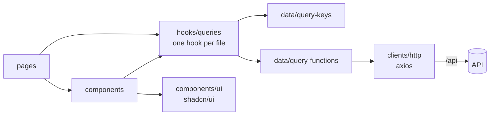

# 06 · Frontend (`apps/web`)

The frontend uses plain functions and hooks, no classes. Components never call the HTTP client directly: data flows page or component → query hook → query function → HTTP client. Forms use React Hook Form with the Zod schemas from `packages/shared`, the same ones the backend validates with.



## Folder layout

```
apps/web/src/
├─ main.tsx                 # providers + router
├─ router.tsx               # route table (React Router)
├─ clients/http.ts          # axios instance and httpClient { get, post, put, patch, delete }
├─ contexts/query-client.tsx# QueryClient: retry, cache time, error toasts for failed queries
├─ data/
│  ├─ query-keys/           # key factories per domain: all, lists(), details(), detail(id)
│  └─ query-functions/      # plain functions per domain that call httpClient
├─ hooks/
│  ├─ queries/<domain>/     # useGetRuns, useGetRunById, useCreateRun, useUploadAsset, …
│  └─ useTheme.ts           # other hooks
├─ layouts/                 # app-layout: header, theme toggle, toaster
├─ pages/                   # runs, add-run, run-details
├─ components/              # brief-form, asset-uploader, run-status-badge, theme-toggle, …
│  └─ ui/                   # shadcn/ui components
├─ utils/                   # helpers (API error messages), upload rules
├─ lib/utils.ts             # shadcn class-name helper
└─ test/                    # MSW server, render helper, setup
```

## Query layer conventions

- **Query keys** live in `data/query-keys/<domain>.ts` as a factory, so invalidation can target all lists or one detail.
- **Query functions** live in `data/query-functions/<domain>.ts` and only call `httpClient`; types come from `packages/shared`.
- **Hooks** live in `hooks/queries/<domain>/`, one per file. Query hooks take optional `queryOptions`; mutation hooks invalidate the affected keys and show an error toast.
- Failed queries show a toast from the shared `QueryCache` handler; form errors are shown next to their fields.

## Theme

Dark is the default (`class="dark"` on `<html>`). The header toggle switches to light and stores the choice in `localStorage`; a small inline script in `index.html` applies it before first paint.

## Pages

| Page                      | Purpose                                                                                                                                         |
| ------------------------- | ----------------------------------------------------------------------------------------------------------------------------------------------- |
| Runs (`/`)                | Lists earlier runs with their status; starts a new run                                                                                          |
| New run (`/runs/new`)     | Collects the brief in a multi-step wizard and uploads the reference files                                                                       |
| Run details (`/runs/:id`) | Shows the brief and uploads; later the phase timeline and each phase result; hosts the approval panel, the slide previews and the export button |

## Brief form fields

1. Brand name, Instagram profile URL and a short reason for choosing the brand.
2. Website, shop and catalogue links (several allowed).
3. Products to promote (name and product page URL).
4. Target audience, goals, role models and inspiration (text and links).
5. Uploads: Instagram screenshots, product photos, logo (PNG or SVG), other references.
6. Output language (Croatian or English) and preferred formats (optional preselection).

## Status updates

The `useGetRunById` hook will poll every 2 seconds while any phase is `RUNNING` and stops when none is. Polling is simpler than server-sent events and is enough for a single user.

## Approval panel

The approval panel turns the phase JSON into an editable form (for example, one card per post in the content plan). Saving sends the edited version with the approval, so the original AI proposal stays untouched in `output`.

> **Current state:** runs list, the brief wizard with uploads and the run details page (brief and references) exist. Phase views, approval and previews follow in M4–M7.
