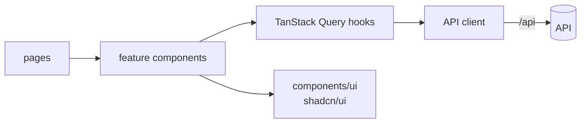

# 06 · Frontend (`apps/web`)

Components never call `fetch` directly. Data flows page → feature component → TanStack Query hook → API client. Forms use React Hook Form with the Zod schemas from `packages/shared`, the same ones the backend validates with.



## Folder layout

```
apps/web/src/
├─ main.tsx, router.tsx     # React Router (or TanStack Router)
├─ pages/
│  ├─ RunsPage.tsx          # list of runs, start a new run
│  ├─ NewRunPage.tsx        # brief form (multi-step wizard)
│  └─ RunDetailPage.tsx     # phase timeline, intermediate results, approval, preview, export
├─ features/
│  ├─ brief/                # BriefForm, LinkListField, AssetUploader (drag and drop)
│  ├─ phases/               # PhaseTimeline, PhaseCard, ApprovalPanel (JSON → editable form)
│  ├─ analysis/             # BrandAnalysisView: verified / assumption labels, source links
│  └─ posts/                # PostPreview (Instagram-like frame), CarouselViewer, CaptionEditor
├─ api/
│  ├─ client.ts             # fetch wrapper, unified error handling
│  ├─ runs.api.ts           # typed calls using the shared DTOs
│  └─ queryKeys.ts
├─ hooks/                   # useRun, useCreateRun, useApprovePhase, useRerunPhase, useUploadAsset
├─ components/ui/           # shadcn/ui components
└─ lib/                     # utilities, form helpers
```

## Pages

| Page | Purpose |
| --- | --- |
| Runs | Lists earlier runs with their status; starts a new run |
| New run | Collects the brief in a multi-step wizard and uploads the reference files |
| Run detail | Shows the phase timeline and each phase result; hosts the approval panel, the slide previews and the export button |

## Brief form fields

1. Brand name, Instagram profile URL and a short reason for choosing the brand.
2. Website, shop and catalogue links (several allowed).
3. Products to promote (name and product page URL).
4. Target audience, goals, role models and inspiration (text and links).
5. Uploads: Instagram screenshots, product photos, logo (PNG or SVG), other references.
6. Output language (Croatian or English) and preferred formats (optional preselection).

## Status updates

The `useRun` hook polls every 2 seconds while any phase is `RUNNING` and stops when none is. Polling is simpler than server-sent events and is enough for a single user.

## Approval panel

The approval panel turns the phase JSON into an editable form (for example, one card per post in the content plan). Saving sends the edited version with the approval, so the original AI proposal stays untouched in `output`.

> **Current state:** a single `App.tsx` page that shows the API health status. Tailwind CSS, shadcn/ui, routing and TanStack Query are added in M1 and M3.
