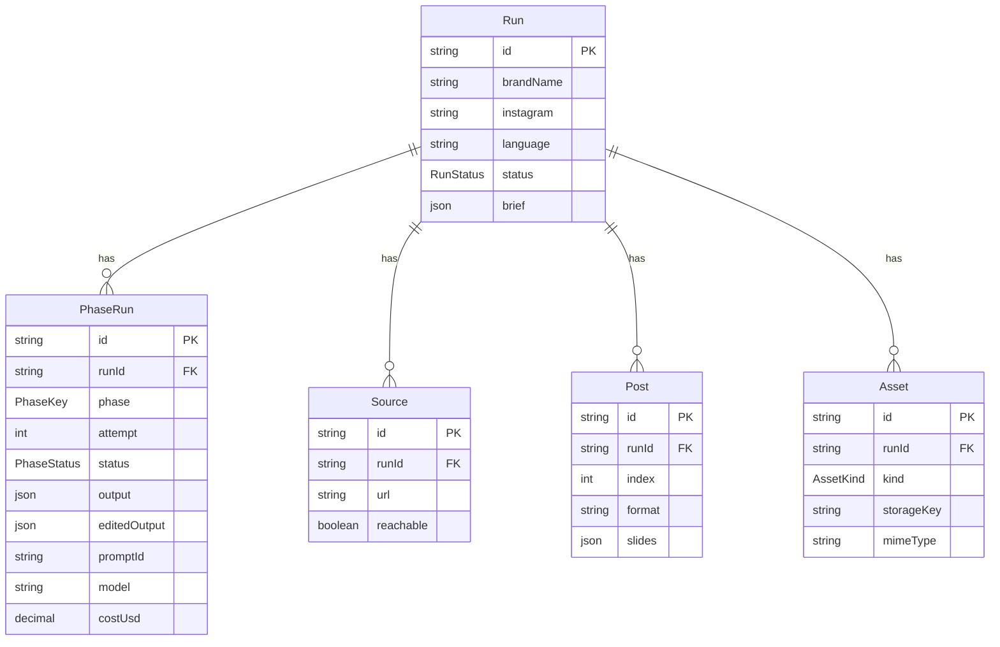

# 07 · Data model

A **Run** is one full execution of the recipe for one brand. Each of its phases is a separate **PhaseRun** row. Files are stored in object storage as **Asset** rows; the database only keeps their keys and metadata.



## Prisma schema

```prisma
enum RunStatus   { DRAFT RUNNING AWAITING_APPROVAL COMPLETED FAILED }
enum PhaseKey    { BRIEF RESEARCH ANALYSIS PLAN COPY VISUALS REVIEW EXPORT }
enum PhaseStatus { PENDING RUNNING AWAITING_APPROVAL APPROVED DONE FAILED STALE }
enum AssetKind   { UPLOAD_SCREENSHOT UPLOAD_PRODUCT UPLOAD_LOGO UPLOAD_OTHER GENERATED_BACKGROUND RENDERED_SLIDE EXPORT_ZIP }

model Run {
  id          String     @id @default(cuid())
  brandName   String
  instagram   String
  language    String     @default("hr")
  status      RunStatus  @default(DRAFT)
  brief       Json
  phases      PhaseRun[]
  assets      Asset[]
  sources     Source[]
  posts       Post[]
  createdAt   DateTime   @default(now())
  updatedAt   DateTime   @updatedAt
}

model PhaseRun {
  id            String      @id @default(cuid())
  runId         String
  run           Run         @relation(fields: [runId], references: [id], onDelete: Cascade)
  phase         PhaseKey
  attempt       Int         @default(1)
  status        PhaseStatus @default(PENDING)
  input         Json?
  output        Json?        // the original AI output
  editedOutput  Json?        // the version edited at approval
  promptId      String?      // e.g. analysis@v3
  model         String?
  tokensIn      Int?
  tokensOut     Int?
  costUsd       Decimal?
  error         String?
  startedAt     DateTime?
  finishedAt    DateTime?
  @@unique([runId, phase, attempt])
}

model Source {
  id         String   @id @default(cuid())
  runId      String
  run        Run      @relation(fields: [runId], references: [id], onDelete: Cascade)
  url        String
  title      String?
  excerpt    String?
  reachable  Boolean
  fetchedAt  DateTime @default(now())
}

model Post {
  id         String   @id @default(cuid())
  runId      String
  run        Run      @relation(fields: [runId], references: [id], onDelete: Cascade)
  index      Int      // 1, 2, 3
  format     String   // IMAGE | CAROUSEL | STORY
  goal       String
  concept    String
  rationale  String
  caption    String?
  hashtags   String[]
  slides     Json     // [{ order, templateId, text, assetId }]
  @@unique([runId, index])
}

model Asset {
  id         String    @id @default(cuid())
  runId      String
  run        Run       @relation(fields: [runId], references: [id], onDelete: Cascade)
  kind       AssetKind
  storageKey String    @unique
  mimeType   String
  width      Int?
  height     Int?
  sizeBytes  Int
  createdAt  DateTime  @default(now())
}
```

## Design notes

- **Attempts, not overwrites.** A re-run adds a `PhaseRun` row with the next `attempt`. The latest attempt per phase is the current one; earlier attempts remain for comparison.
- **`output` vs. `editedOutput`.** The AI proposal is never changed. Approval writes the human version next to it.
- **Cascade deletes.** Deleting a run removes its phases, sources, posts and asset rows. The storage objects are deleted by the service, not by the database.
- **Job tables.** pg-boss keeps its jobs in its own `pgboss` schema in the same database. No Prisma model is needed for them.
- **Data for the PDF.** Time and cost per phase, the models and prompt versions used, and the `output` vs. `editedOutput` difference all come from `PhaseRun`.

## Future: feedback

A later `Feedback` table can collect edits made at approval and the results of published posts. These can be fed back into the prompts as examples, which is the learning proposal in the PDF.
