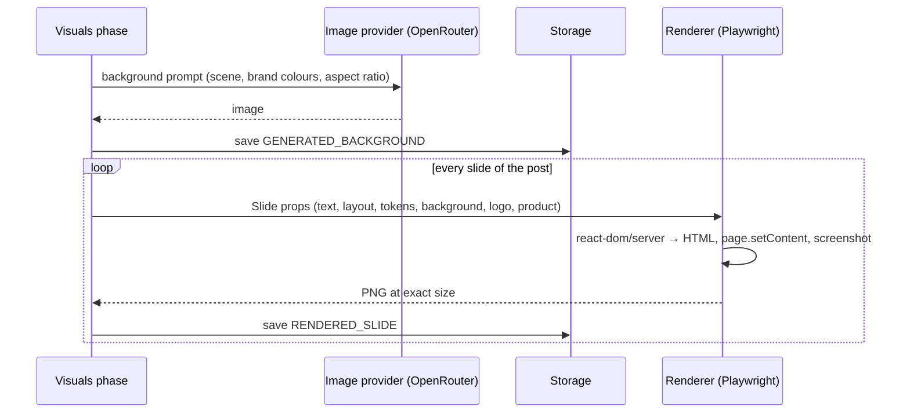

# 09 · Storage and rendering

Files live in S3-compatible object storage. Slides are not drawn by an AI model: they are React templates rendered to PNG by Playwright. The image model supplies the scene, with the product placed in it from the uploaded photo; the caption and logo are drawn by the template, so they stay exact.

## Object storage

| Topic         | Design                                                                                                                                                       |
| ------------- | ------------------------------------------------------------------------------------------------------------------------------------------------------------ |
| Client        | AWS SDK v3 S3 client with path-style addressing: SeaweedFS locally, Cloudflare R2 in production ([ADR 0008](adr/0008-seaweedfs-locally-r2-in-production.md)) |
| Bucket        | `ai-post-recipe`, created by the API at startup if missing                                                                                                   |
| Key layout    | `runs/{runId}/{kind}/{assetId}.{ext}`                                                                                                                        |
| Access        | The browser never reads the bucket. The API streams the file (`GET /api/assets/:id`), so storage URLs never leave the server                                 |
| Upload checks | MIME type allow-list and a 10 MB size limit; width and height read with sharp                                                                                |

## Slide rendering

1. One template, `Slide` in `packages/slide-templates`, with three layouts: **cover** (first slide; headline at the bottom), **text** (middle slides; text over a darkened background) and **closing** (last slide; text and a brand button). A single-image post uses only its first slide text, as a cover.
2. Props: `format`, `layout`, `text`, `order`/`total` (shown as 2/5 on carousels and stories), `brandName`, `tokens` (accent colour from the analysis, Geist font), `backgroundUrl`, `logoUrl`. All images are data URLs.
3. The logo is the uploaded `UPLOAD_LOGO` (SVG turned into PNG); each post sends the photo of its own product to the image model (matched by name in the brief's order, otherwise one per post in turn). Without product photos the scene shows no product; in website mode the website screenshots only go to the image model, as input for the background. Without a logo the header shows the brand name.
4. One background per post: the image model gets the brand, colours, visual style and a scene theme (product and goal), and is told to draw no text, design elements, products or people. Feed and carousel use 4:5, stories 9:16.
5. Chromium screenshots the page at 1080×1350 (feed, carousel) or 1080×1920 (story) after the fonts have loaded. Text is real text, never part of the generated image.
6. The PNGs are saved as `RENDERED_SLIDE` assets and written onto the post's slides. The web app shows these PNGs in an Instagram-like preview.

## Regenerating a slide

`POST /api/runs/:id/posts/:index/slides/:order/regenerate` makes a new background (with an optional instruction such as "darker background") and renders that one slide again; the other slides stay. It runs in the request (about 10 s), is refused while a phase runs, counts toward the cost cap, and its cost is added to the visuals phase. The review phase will use the same path when a slide fails a check.

## Video (optional)

Not in the MVP. If time allows, ffmpeg can turn the story images into a simple slideshow reel.

> **Current state:** storage, uploads, background generation, slide rendering and regeneration work; the API image is based on the Playwright image.
