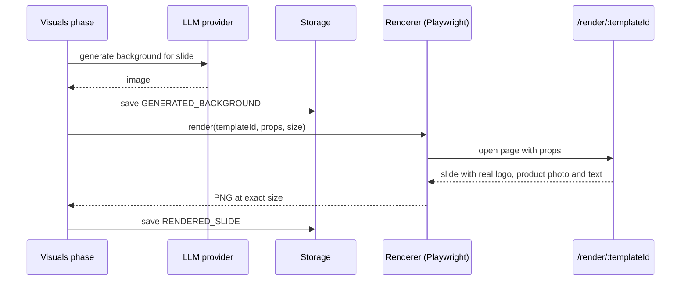

# 09 · Storage and rendering

Files live in S3-compatible object storage. Slides are not drawn by an AI model: they are React templates rendered to PNG by Playwright. The image model only supplies the background, so the caption, logo and product photo stay exact.

## Object storage

| Topic         | Design                                                                                                                                                       |
| ------------- | ------------------------------------------------------------------------------------------------------------------------------------------------------------ |
| Client        | AWS SDK v3 S3 client with path-style addressing: SeaweedFS locally, Cloudflare R2 in production ([ADR 0008](adr/0008-seaweedfs-locally-r2-in-production.md)) |
| Bucket        | `ai-post-recipe`, created by the API at startup if missing                                                                                                   |
| Key layout    | `runs/{runId}/{kind}/{assetId}.{ext}`                                                                                                                        |
| Access        | The browser never reads the bucket. The API streams the file (`GET /api/assets/:id`), so storage URLs never leave the server                                 |
| Upload checks | MIME type allow-list and a 10 MB size limit; width and height read with sharp                                                                                |

## Slide rendering

1. Templates live in `packages/slide-templates` (carousel, single image, story).
2. Template props: `brandTokens` (colours and font from the brand analysis), `text`, `backgroundUrl`, `productImageUrl`, `logoUrl`, `slideIndex`.
3. The API serves an internal `/render/:templateId` page that shows a template with the given props.
4. Headless Chromium takes a screenshot at the exact size: 1080×1350 for feed and carousel, 1080×1920 for stories.
5. The PNG is saved to storage as a `RENDERED_SLIDE` asset.
6. The same template runs in the frontend preview, so what the user approves is exactly what is exported.

## Regenerating a slide

`POST /api/runs/:id/posts/:index/slides/:order/regenerate` re-runs the background and render steps for one slide, with an optional instruction such as "darker background". The review phase uses the same path when a slide fails a check.

## Video (optional)

Not in the MVP. If time allows, ffmpeg can turn the story images into a simple slideshow reel.

> **Current state:** storage, uploads and streaming work. The API image is based on `node:24-alpine`; it moves to the Playwright base image in M7, when rendering is added.
