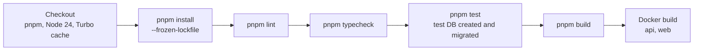

# 11 · Testing and CI/CD

Tests never call the real OpenRouter or Serper API, so they run without keys, for free and deterministically. A separate, manually started `pnpm test:live` runs one full recipe with a real key; it never runs in CI.

## Test layers

| Layer      | Tools                    | What it tests                                                                  | External dependencies                                               |
| ---------- | ------------------------ | ------------------------------------------------------------------------------ | ------------------------------------------------------------------- |
| Unit (api) | Vitest                   | Service and phase logic, the state machine, Zod validation, grounding rules    | All providers mocked (`FakeLlmProvider` returns recorded JSON)      |
| API (api)  | Vitest + Supertest       | Endpoints, status codes, errors, state transitions (for example approve → 409) | Real PostgreSQL (a service container in CI); LLM and storage mocked |
| Unit (web) | Vitest + Testing Library | Brief form validation, the approval panel, hooks                               | MSW for the network                                                 |
| Renderer   | Vitest + Playwright      | A template renders at the expected size and shows the logo                     | Local files                                                         |

## Code style

- **ESLint** with type-aware `typescript-eslint` rules, shared from `packages/eslint-config`. The web app adds the React Hooks rules and forbids relative imports (use the `@/` alias).
- **Prettier** formats everything: single quotes, no semicolons, sorted imports, sorted Tailwind classes.
- TypeScript stays on 6.0 because `typescript-eslint` does not support TypeScript 7 yet.
- `.vscode/settings.json` formats on save and applies ESLint fixes.

## Test database

API tests never touch the development database. Before the tests, a Vitest global setup derives a `<name>_test` database from `DATABASE_URL` (locally `recipe_test` next to `recipe`), creates it if it is missing and applies the migrations. Every test file gets that URL, and the test context refuses to start against any database whose name does not end in `_test`. Tests delete the runs they create; a crashed test can only leave rows in the test database.

## CI pipeline

GitHub Actions (`.github/workflows/ci.yml`) runs on every push and pull request:

1. Check out, set up pnpm and Node 24, restore the Turborepo cache.
2. `pnpm install --frozen-lockfile`.
3. `pnpm lint` (ESLint) and `pnpm format:check` (Prettier). A failure stops the pipeline.
4. `pnpm typecheck`.
5. `pnpm test` (unit and API); the test setup creates and migrates the test database in the PostgreSQL service container.
6. `pnpm build`.
7. Build the `api` and `web` Docker images, so the Dockerfiles are checked too.

The `main` branch is protected: merging requires a green pipeline.
