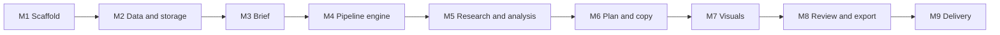

# Milestones

The app is built in nine milestones, from an empty scaffold to the handed-in recipe. Each milestone ends with something that can be tried in the browser. The requirements are listed once in [requirements.md](requirements.md); each milestone links to the ones it delivers.

| Milestone | Goal | Status |
| --- | --- | --- |
| [M1 · Scaffold](m1-scaffold.md) | Monorepo, empty apps, database, Docker, tooling and CI | In progress |
| [M2 · Data and storage](m2-data-and-storage.md) | Prisma schema, repositories, object storage, uploads | Not started |
| [M3 · Brief](m3-brief.md) | Create a run from a validated brief with uploads | Not started |
| [M4 · Pipeline engine](m4-pipeline-engine.md) | Jobs, phase runner, state machine, approval and re-run | Not started |
| [M5 · Research and analysis](m5-research-and-analysis.md) | Real sources and a grounded brand analysis | Not started |
| [M6 · Plan and copy](m6-plan-and-copy.md) | Three post plans and their copy, editable at approval | Not started |
| [M7 · Visuals](m7-visuals.md) | Slide templates, backgrounds, PNG rendering, preview | Not started |
| [M8 · Review and export](m8-review-and-export.md) | Automatic checks, ZIP export, the three demo posts | Not started |
| [M9 · Delivery](m9-delivery.md) | One-command start, recipe document, PDF, published images | Not started |

## Definition of done

A milestone is done when all of these hold:

- [ ] `pnpm lint`, `pnpm typecheck` and `pnpm test` pass locally and in CI.
- [ ] The feature can be tried in the browser (or with `curl` for API-only work).
- [ ] New behaviour has tests at the right layer ([Testing and CI/CD](../architecture/11-testing-and-ci.md)).
- [ ] No test calls a real external API.
- [ ] Architecture docs are updated where the code differs from them.
- [ ] `.env.example` lists every new variable.

## Personas

| Persona | Who | Wants |
| --- | --- | --- |
| **Operator** | The person creating posts for a brand | To go from a brief to three good posts quickly, correcting the AI where needed |
| **Reviewer** | The person assessing the project | To start the app with one command and their own key, and to see how each result was produced |
| **Developer** | Whoever extends the code | Clear layers, fast tests without keys, one place for contracts |

User stories in the milestone files use these personas.

## Conventions

- Requirements: `FR-nn` (functional) and `NFR-nn` (non-functional), defined in [requirements.md](requirements.md).
- User stories: `US-<milestone>.<n>`, written as *As a … I want … so that …*, each with acceptance criteria.
- Tasks: checkboxes in the milestone file, ticked when merged to `main`.
